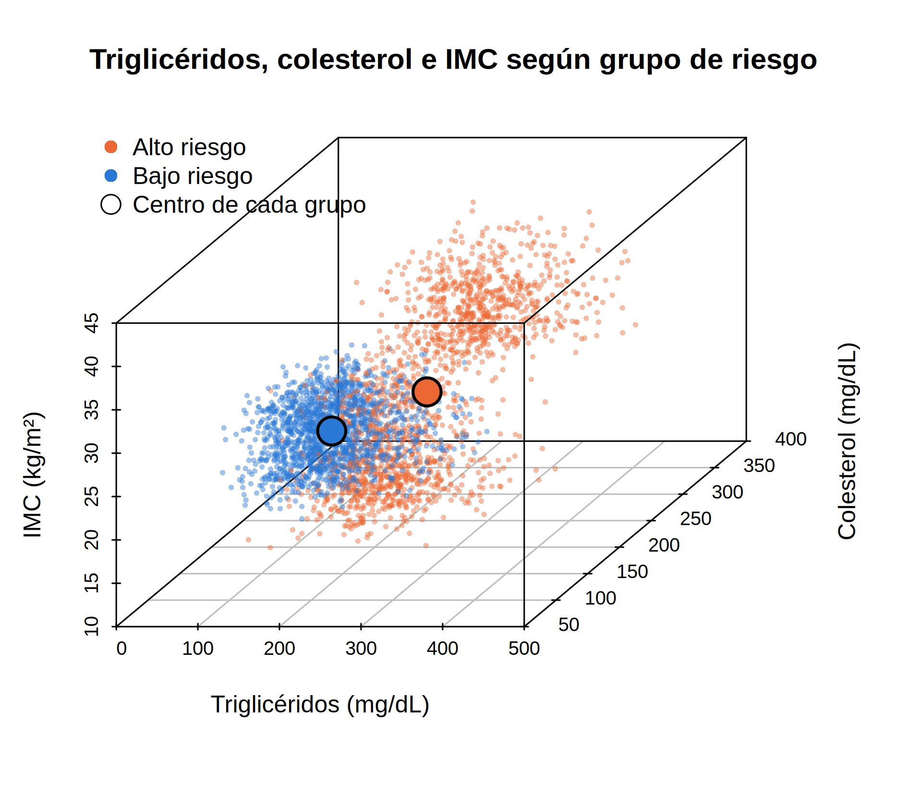
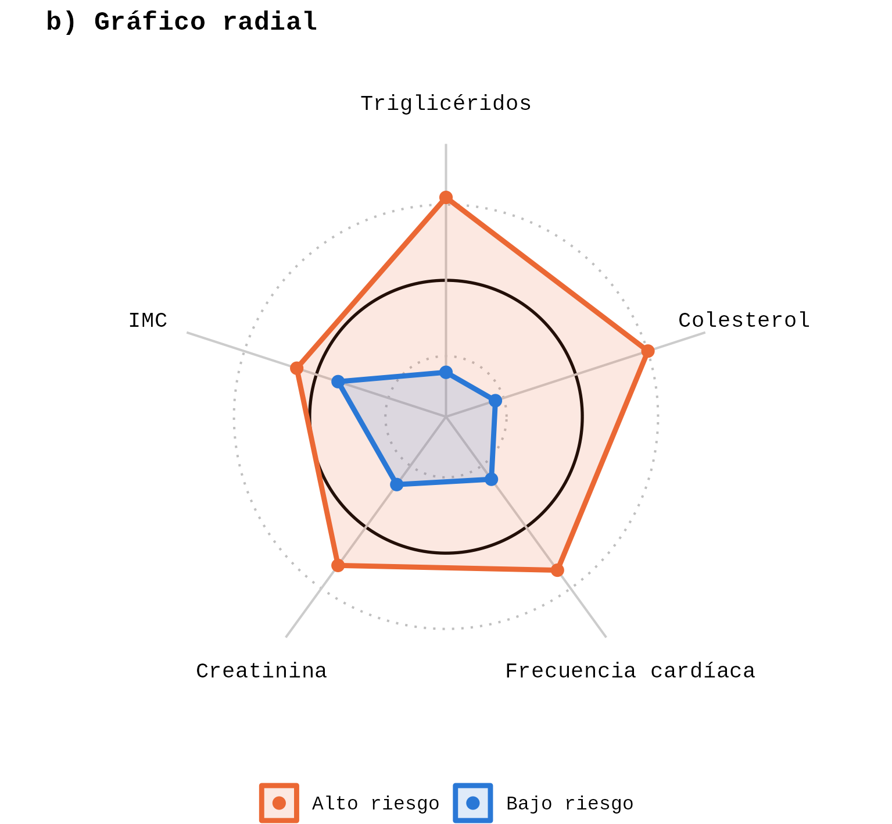
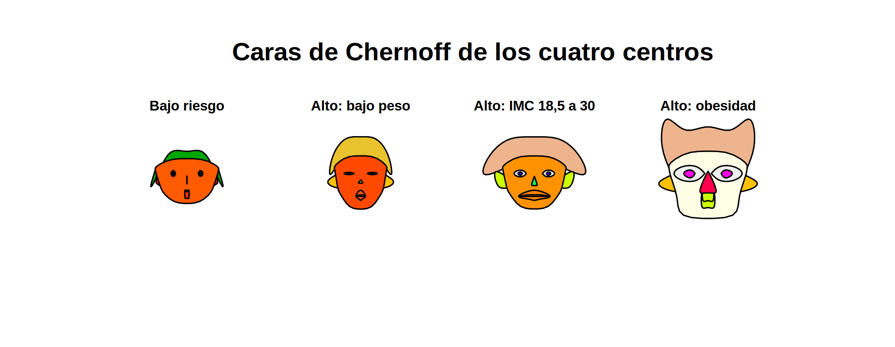

# Análisis multivariado de riesgo cardiovascular — Hospital 4

Análisis exploratorio multivariado sobre 13.331 registros clínicos para identificar qué variables distinguen a un paciente de alto riesgo de uno de bajo riesgo, y cuánta de la información registrada en cada control es realmente necesaria para establecer esa distinción.

## Problema

El Hospital 4 registra 18 variables cuantitativas y 10 categóricas en cada control. El objetivo fue determinar:

1. Qué variables separan realmente a los grupos de riesgo.
2. Si esas variables dicen cosas distintas o se superponen.
3. Si el grupo de alto riesgo es homogéneo o contiene subgrupos con perfiles clínicos distintos.

## Datos

- **Fuente:** `Hospital_4.csv` (dataset de cátedra, 15.345 registros originales).
- **Registros finales:** 13.331 (tras limpieza y validación).
- **Variables:** 36 (18 cuantitativas originales + derivadas).
- **Variable objetivo:** `categoria_riesgo` (alto_riesgo / bajo_riesgo).

## Métodos

### Limpieza (`01_limpieza.ipynb`)
- Detección y conteo de códigos de error (`ERROR_nnn`).
- Unificación de categorías mal escritas (`h1gh`, `lwo`, `modrate`, etc.).
- Tratamiento de NAs: eliminación de filas con 7 o más faltantes.
- Validación clínica de rangos (frecuencia cardíaca 30-220 bpm).
- Ingeniería de variables: indicador de anemia, taquicardia, colesterol alto, categoría de creatinina.

### Análisis (`02_analisis.ipynb`)
- **Comparación univariada:** t de Welch, Wilcoxon-Mann-Whitney, Levene, d de Cohen.
- **Comparación multivariada:** T² de Hotelling con diagnóstico de normalidad (Q-Q, curtosis de Mardia).
- **Estructura conjunta:** ACP sobre matriz de correlación, criterio de Kaiser, KMO, Bartlett.
- **Subgrupos:** Kruskal-Wallis, perfiles por categoría de IMC.
- **Visualización:** dispersión 3D, coordenadas paralelas, perfiles multivariados, gráfico radial, diagramas de estrellas, caras de Chernoff.

## Hallazgos principales

1. **Cinco variables discriminan:** triglicéridos, colesterol, frecuencia cardíaca, creatinina e IMC (|d| ≥ 0,20). Las trece restantes no separan los grupos.
2. **La distancia multivariada de las cinco discriminantes es 2,1 veces mayor** que la de las trece restantes (T² de Hotelling).
3. **El ACP confirma dos ejes:** un eje lipídico-adiposo (CP1) y un eje cardio-renal (CP2).
4. **El alto riesgo no es homogéneo:** contiene tres perfiles clínicos distintos según el IMC (bajo peso, IMC 18,5-30, obesidad).
5. **La glucosa no separa riesgo:** su efecto se explica por el diagnóstico, no por la categoría de riesgo.

   ## Visualizaciones

## Contacto

- **Autor:** Augusto Barzola
- **GitHub:** [@augusbarzola-arch](https://github.com/augusbarzola-arch)
- **LinkedIn:** [tu perfil](https://linkedin.com/in/tu-perfil)
- **Email:** augus.barzola@gmail.com
